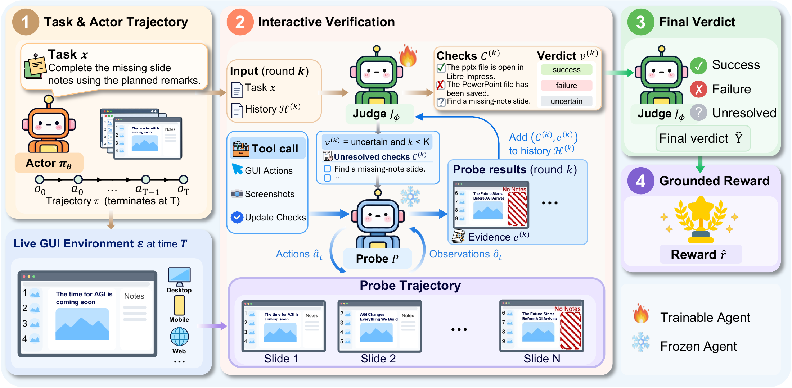
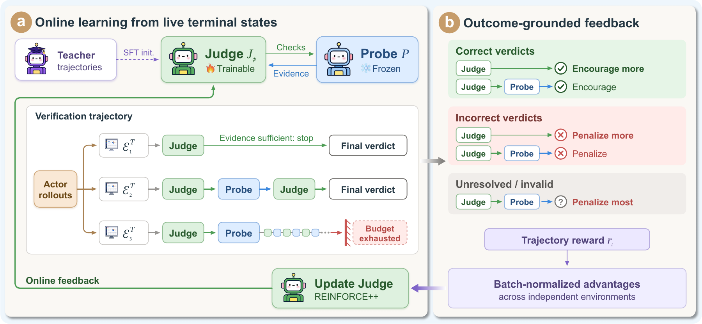

<div align="center">

# VeriCUA

### Learning Proactive Verification for Reliable GUI Agent Rewards

[](https://github.com/Jeffjeno/VeriCUA)
[](#installation)
[](LICENSE)

Zhizhou Wang<sup>1,&ast;</sup>, Yaxi Lu<sup>2,&ast;</sup>, Zhong Zhang<sup>3,†</sup>, Zikun Hu<sup>4</sup>, Xin Cong<sup>2</sup>, Yankai Lin<sup>5</sup>, Fangming Liu<sup>6,†</sup>

<sup>1</sup>Southwest Jiaotong University · <sup>2</sup>Tsinghua University · <sup>3</sup>University of Electronic Science and Technology of China<br>
<sup>4</sup>National University of Singapore · <sup>5</sup>Renmin University of China · <sup>6</sup>Peng Cheng Laboratory

<sup>&ast;</sup>Equal contribution · <sup>†</sup>Corresponding authors

</div>

<p align="center">
  
</p>

## Overview

**VeriCUA** is a proactive reward agent for GUI tasks. A trainable **Judge** formulates task-success checks and predicts `success`, `failure`, or `uncertain`. When evidence is missing, a frozen **Probe** inspects the live GUI environment and returns observations, and the Judge revises its verdict. The Judge is initialized from teacher traces and optimized with **REINFORCE++**, learning what to check and when to stop.

- **Learned verification.** Training improves both check formulation and stop-or-probe decisions.
- **Transfer across interfaces.** Trained only on OSWorld, VeriCUA transfers to MobileWorld and WebArena-Verified without further training.
- **Reliable and efficient.** VeriCUA-4B improves macro-average agreement over few-shot GPT-5.4 by **5.36 points** with **47.6%–59.8% fewer Probe tokens**.
- **Better Actor learning.** As a frozen reward source, it raises downstream Actor Pass@4 by **3.21 points** overall and **5.40 points** on held-out MultiApp tasks.

## Results

Reward agreement with executable evaluators, Avg@4 (%).

| Judge | OSWorld | MobileWorld | WebArena-Verified | Macro Avg. |
|---|---:|---:|---:|---:|
| GPT-5.4 (few-shot) | 81.40 | 66.25 | 58.50 | 68.72 |
| Qwen3-VL-4B-Thinking | 73.73 | 73.50 | 61.50 | 69.58 |
| **VeriCUA-4B** | **82.00** | **77.50** | **62.75** | **74.08** |
| VeriCUA-2B | 77.84 | 72.50 | 62.00 | 70.78 |
| VeriCUA-1B | 77.11 | 75.50 | 62.25 | 71.62 |

## Installation

```bash
git clone https://github.com/Jeffjeno/VeriCUA.git
cd VeriCUA

python3.12 -m venv .venv && source .venv/bin/activate
pip install -r requirements.txt
```

OSWorld environments run in Docker; see the [Docker setup guide](desktop_env/providers/docker/DOCKER_GUIDELINE.md). Model weights will be released on Hugging Face.

## Evaluation

```bash
export JUDGE_CHECKPOINT=/path/to/VeriCUA-4B
export PATH_TO_VM=/path/to/Ubuntu.qcow2
export PROBE_BASE_URL=http://127.0.0.1:30000/v1   # Holo3.1-35B-A3B Probe

bash suites/osworld_judge/run.sh "$JUDGE_CHECKPOINT"
bash suites/osworld_judge/run.sh score_raw "$JUDGE_CHECKPOINT"   # Avg@4
```

Dataset layout and Judge–Probe settings: [`config/eval_datasets/osworld.yaml`](config/eval_datasets/osworld.yaml), [`suites/osworld_judge/judge.yaml`](suites/osworld_judge/judge.yaml).
For other benchmarks, see [MobileWorld](suites/mobileworld/README.md) and [WebArena-Verified](suites/webarena/README.md).

## Training

<p align="center">
  
</p>

**1. Cold-start data.** Collect Actor rollouts, verify them with the Judge–Probe loop, and export SFT data (we use LLaMA-Factory for SFT):

```bash
bash train/guirl_sft/run_sft.sh train/guirl_sft/configs/sft_qwen3vl4b.yaml
```

**2. Online Judge RL.** REINFORCE++ with a frozen Probe on 280 OSWorld tasks and four frozen Actors (see the [RL guide](train/rft/README.md)):

```bash
bash train/rft/start_env.sh   # environment services
bash train/rft/run.sh         # trainer
```


## Citation

```bibtex
@misc{wang2026vericua,
  title  = {VeriCUA: Learning Proactive Verification for Reliable GUI Agent Rewards},
  author = {Zhizhou Wang and Yaxi Lu and Zhong Zhang and Zikun Hu and Xin Cong and Yankai Lin and Fangming Liu},
  year   = {2026},
  note   = {Preprint}
}
```

## Acknowledgements

Built on [OSWorld](https://github.com/xlang-ai/OSWorld) and [Slime](https://github.com/THUDM/slime). 
